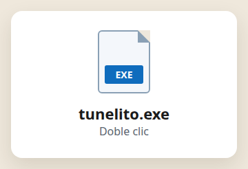
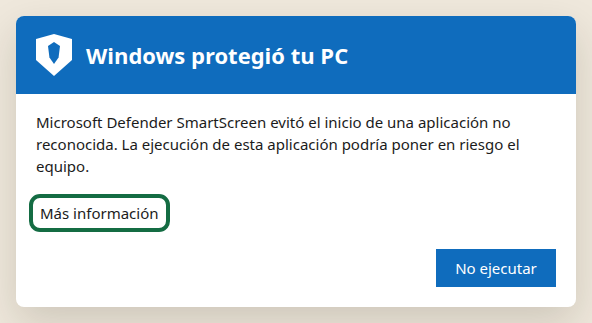
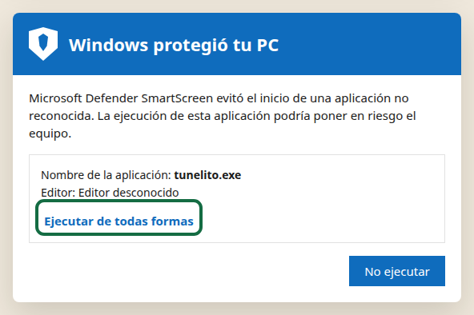
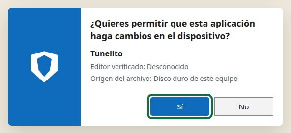
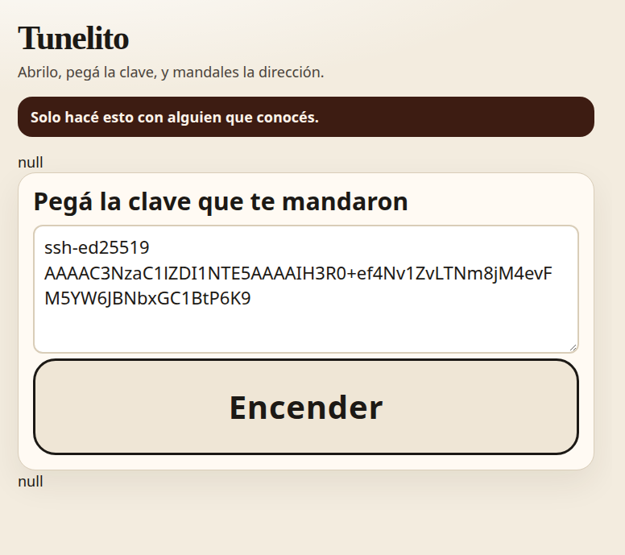
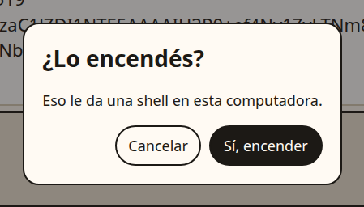
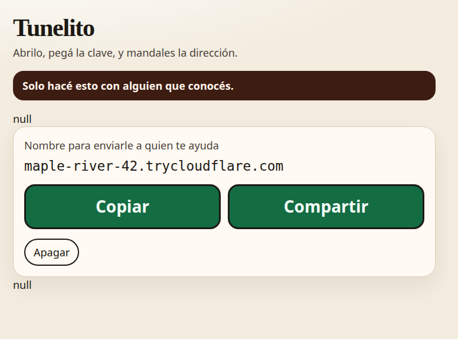

# Para vos

Alguien que conocés te va a ayudar con esta computadora. Te manda una clave por WhatsApp. Esta página es todo lo que tenés que hacer.

**Si no conocés a esa persona, no abras nada.**

## 1. Bajá el archivo

Se llama `tunelito.exe`. Te lo manda esa persona, o te pasa el enlace.

{ width="280" }

## 2. Abrilo

Doble clic. No hay un instalador. Se abre una ventana.

Si Windows dice que protegió tu PC, el archivo todavía no está firmado. No está roto. Tocá **Más información**.

{ width="520" }

Después tocá **Ejecutar de todas formas**.

{ width="520" }

Windows pregunta si querés permitir cambios. Tocá **Sí**. Es la única vez.

{ width="520" }

## 3. Pegá la clave

En WhatsApp, copiá el mensaje entero. Empieza con `ssh-ed25519`.

En la ventana, el recuadro dice **Pegá la clave que te mandaron**. Pegála ahí.

{ width="520" }

## 4. Encendé

Tocá **Encender**. Te pregunta una vez. Tocá **Encender** otra vez.

{ width="360" }

## 5. Mandá la dirección

Aparece una dirección que termina en `trycloudflare.com`. Tocá **Copiar** o **Compartir** y mandála por WhatsApp, a la misma persona.

{ width="520" }

La dirección sola no deja entrar a nadie. Hace falta la clave que pegaste.

## 6. Apagá

Cuando terminen, tocá **Apagar**. Está debajo de Copiar. También se apaga si cerrás la ventana, o solo, a las dos horas.

Si lo abrís de nuevo, no se enciende solo. Si te piden otra vez, repetí desde el paso 3.
