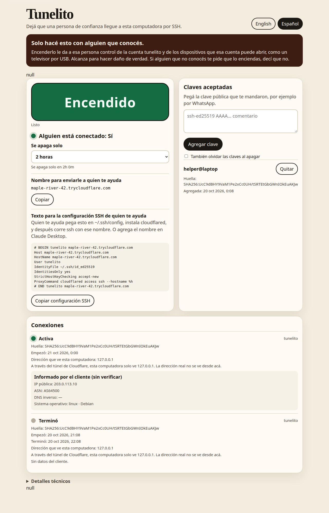

# Tunelito

Tunelito es una ventana en **esta** computadora. La encendés para que una persona que ya conocés pueda entrar por SSH a través de NAT, y después abrir una sesión SSH de Claude Desktop o usar un dispositivo local, como un televisor por USB.

Es para que un amigo ayude a un amigo. Si alguien que no conocés te pide que lo instales, decí que no.

La imagen es la ventana real con datos de ejemplo. No es un túnel en vivo.

## Qué hacen

1. Quien ayuda instala `cloudflared` y te manda una clave pública (`ssh-keygen`, o el programa opcional `tunelito-connect`).
2. Pegás esa clave, encendés el interruptor, y devolvés el bloque de configuración SSH que copia la ventana.
3. Quien ayuda pega ese bloque en `~/.ssh/config` y corre `ssh el-nombre.trycloudflare.com`, o agrega ese nombre en Claude Desktop.

El bloque es OpenSSH común: `User tunelito` y `ProxyCommand cloudflared access ssh --hostname %h`. Para conectarse no hace falta otro programa.

## Seguí por acá

- [Instalar en esta computadora](install.md) cubre Debian, Windows y macOS.
- [Conectarse por SSH](connect.md) es el camino de quien ayuda, incluyendo Claude Desktop.
- [Seguridad](security.md) es el modelo de amenazas: quién puede hacer daño, y qué hace el interruptor al respecto.

El interruptor se apaga solo. Nada de Tunelito arranca al iniciar el equipo.

El español de estas páginas es rioplatense, igual que la ventana.
