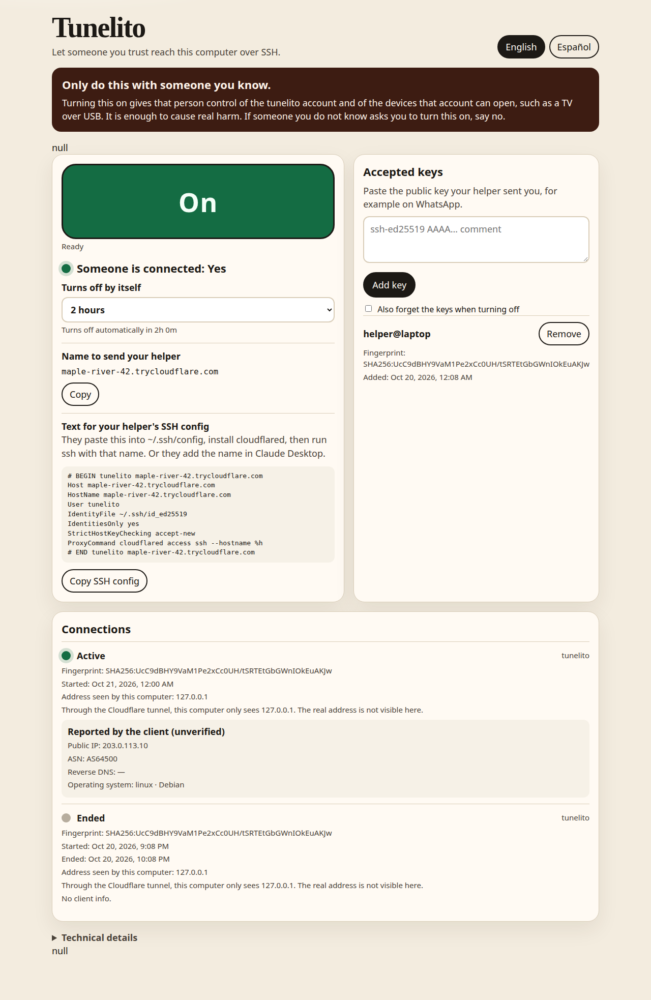

# Tunelito

Tunelito is a window on **this** computer. You turn it on so someone you already know can SSH in through NAT, then open a Claude Desktop SSH session or use a local device, such as a TV over USB.

It is for a friend helping a friend. If a stranger asks you to install it, say no.

The picture is the real window with sample data. It is not a live tunnel.

## What you do

1. The helper installs `cloudflared`, and sends you a public key (`ssh-keygen`, or the optional `tunelito-connect`).
2. You paste that key, turn the switch on, and send back the SSH config block the window copies.
3. The helper pastes that block into `~/.ssh/config` and runs `ssh the-name.trycloudflare.com`, or adds that name in Claude Desktop.

The block uses ordinary OpenSSH: `User tunelito` and `ProxyCommand cloudflared access ssh --hostname %h`. No extra client is required to connect.

## Read next

- [Install on this computer](install.md) covers Debian, Windows, and macOS.
- [Connect with SSH](connect.md) is the helper's path, including Claude Desktop.
- [Security](security.md) is the threat model: who can do harm, and what the switch does about it.

The switch turns itself off. Nothing in Tunelito starts at boot.
